# SkyEar

**A pocket radio that listens to lightning thousands of miles away.**

Lightning strikes somewhere on Earth dozens of times every second, and every strike gives off a burst of very-low-frequency (VLF) radio. SkyEar picks those bursts up with a wire antenna, cleans them up, and plays them through headphones. You hear distant storms as crackling ("sferics"), and sometimes as eerie falling whistles ("whistlers"): lightning signals that went out into space, followed Earth's magnetic field, and came back down.

I'm building it for [Hack Club Half Life](https://halflife.hackclub.com) (Week 1: PCB design).

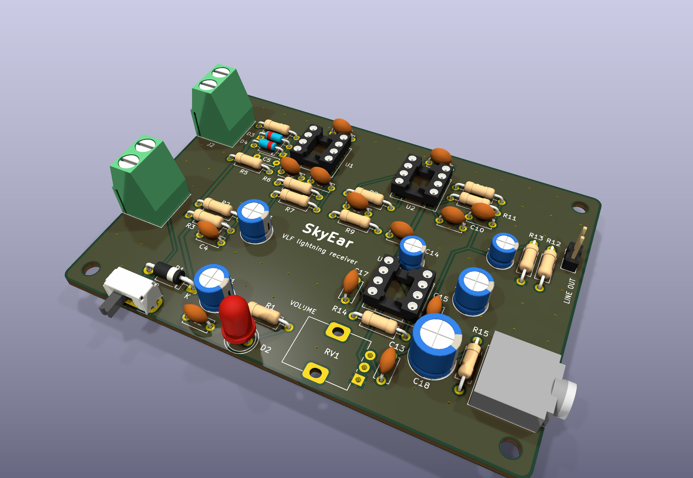

## How it works

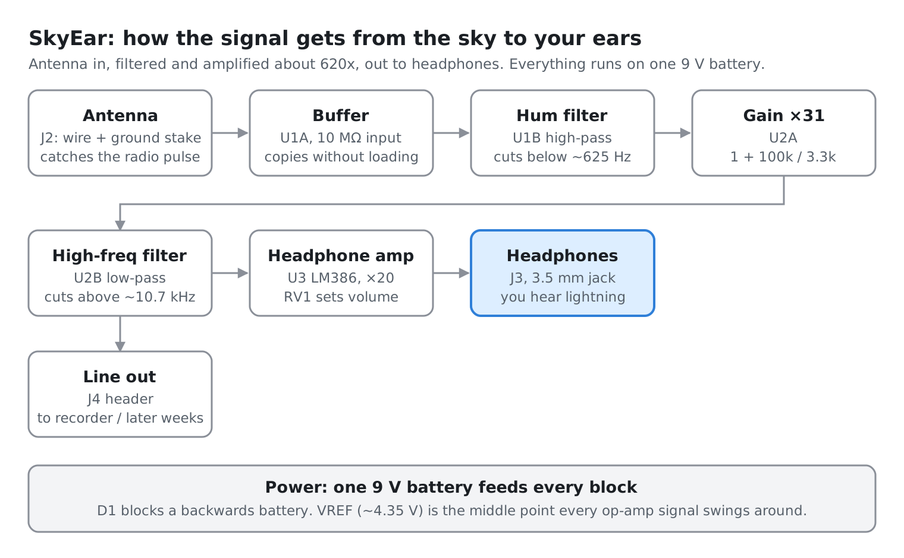

SkyEar is a fully analog circuit: two op-amp chips, one headphone amp chip, and a 9 V battery. The signal goes through it in this order:

| Stage | Part | What it does |
| --- | --- | --- |
| Antenna input | J2, R4, D3, D4 | A wire antenna plus a ground stake. The diodes dump static from the antenna safely into the power rails. |
| Buffer | U1A (TL072), R5 = 10 MΩ | A short antenna acts like a tiny capacitor (~10–30 pF), so it can barely push any current. The 10 MΩ input and a JFET op-amp copy the signal without draining it. |
| Hum filter | U1B, C6, C7, R6, R7 | 2nd-order high-pass at ~625 Hz. Power lines put out 60 Hz hum that's way louder than lightning on another continent, so this cuts it. |
| Gain | U2A, R8, R9 | Amplifies by 1 + 100k / 3.3k ≈ 31. |
| High-frequency filter | U2B, R10, R11, C10, C11 | 2nd-order low-pass at ~10.7 kHz. Cuts hiss, AM radio, and the Navy's VLF transmitters (~20–25 kHz). |
| Headphone amp | U3 (LM386), RV1 | Another 20x, with a volume knob. About 620x total from antenna to ears. |
| Line out | J4 | A clean copy of the audio for recording, or for my later Half Life projects. |
| Power | J1, SW1, D1, R2, R3 | 9 V battery with reverse-polarity protection. R2/R3 make a ~4.35 V "virtual ground" (VREF) so the op-amps can swing both ways on one battery. |

The filter cutoffs come from the standard formulas:

- Input: f = 1 / (2π · 10 MΩ · 30 pF) ≈ 530 Hz
- Hum filter: f = 1 / (2π · 10 nF · √(18 kΩ · 36 kΩ)) ≈ 625 Hz
- Low-pass: f = 1 / (2π · 10 kΩ · √(2.2 nF · 1 nF)) ≈ 10.7 kHz

## Schematic

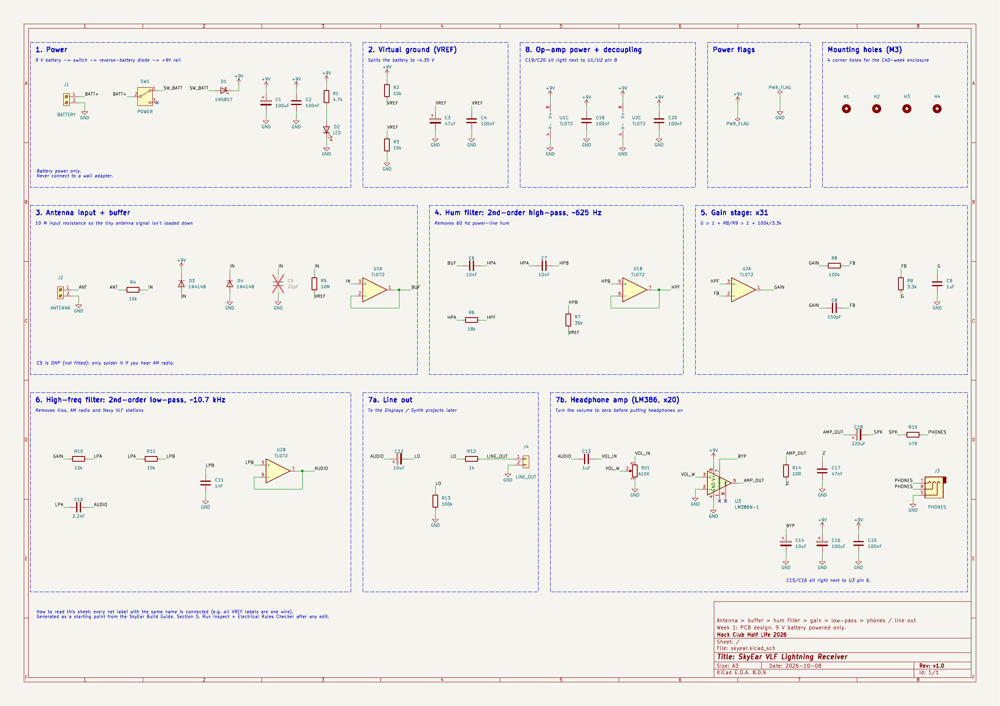

The full KiCad project is in [`pcb/`](pcb/). Open `pcb/skyear.kicad_pro` in KiCad 10 (the schematic alone also opens in KiCad 8 and 9). A PDF copy is at [`pcb/skyear_schematic.pdf`](pcb/skyear_schematic.pdf).

### Block by block

**Power:** 9 V battery → slide switch → 1N5817 Schottky diode (blocks a backwards battery, only ~0.3 V drop) → +9V rail, with a power LED.

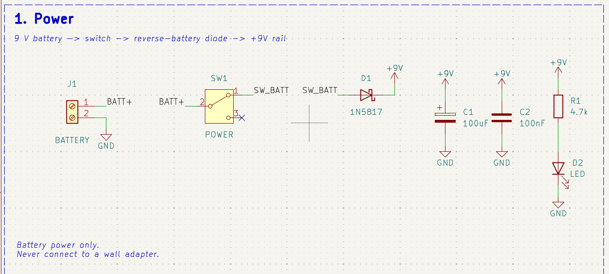

**Virtual ground:** two 10k resistors split the battery to ~4.35 V so every op-amp signal can swing above and below it.

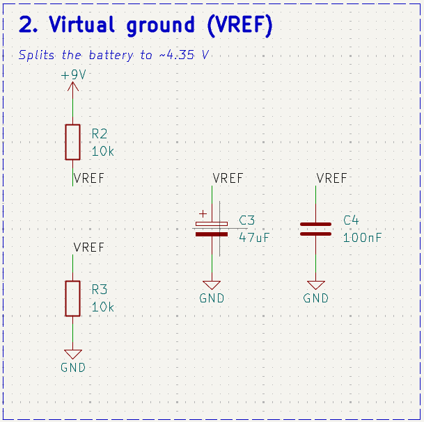

**Antenna input + buffer:** R5 is 10 MΩ so the antenna's tiny signal isn't loaded down, and U1A just copies it.

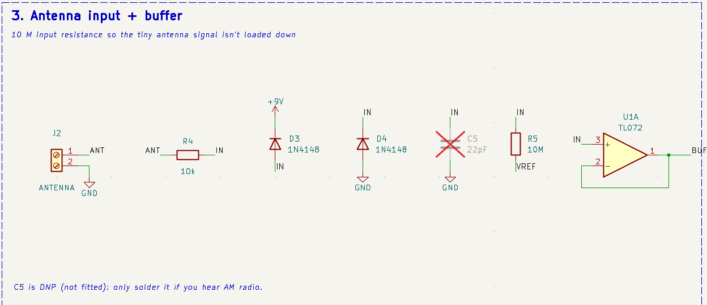

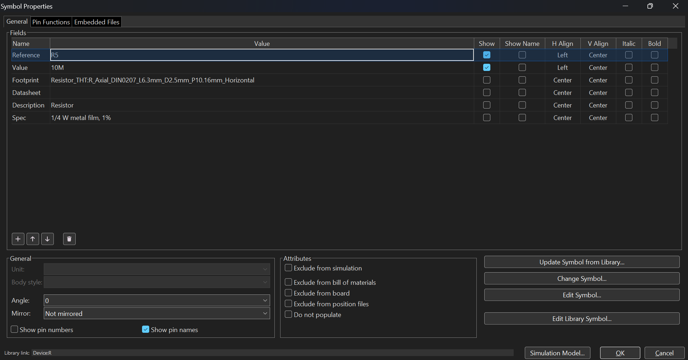

C5 (22 pF) is marked "do not fit". It only gets soldered if AM radio leaks in.

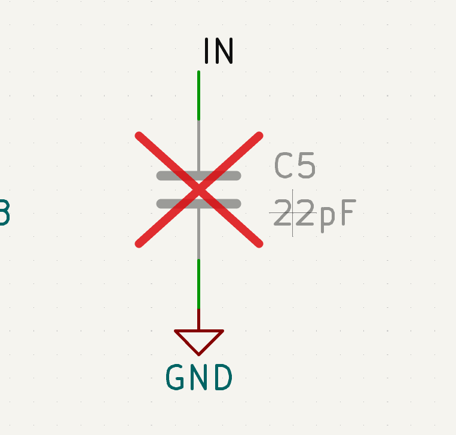

**Hum filter:** R7 (36k) is exactly twice R6 (18k), which gives a flat Butterworth response with no bump at the cutoff.

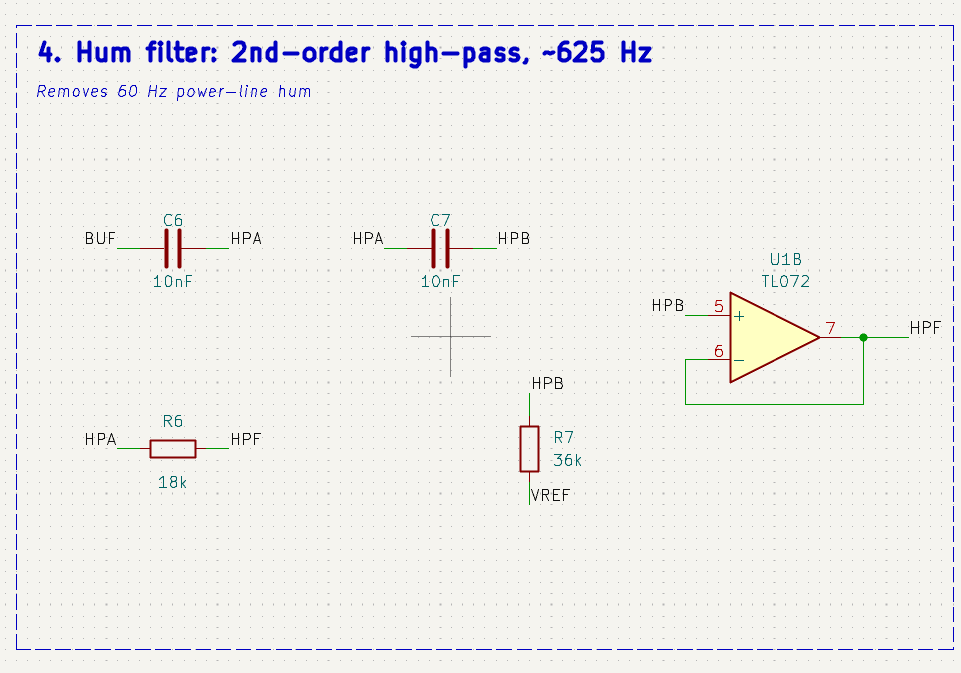

**Gain stage:** x31. C9 keeps DC from being amplified and C8 starts rolling off the highs.

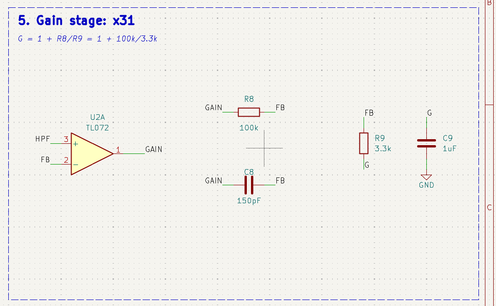

**High-frequency filter:** cuts everything above ~10.7 kHz.

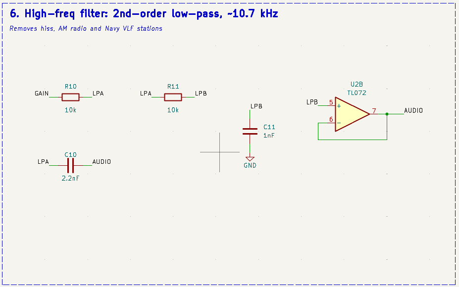

**Line out:** a DC-blocked copy of the audio on a 2-pin header.

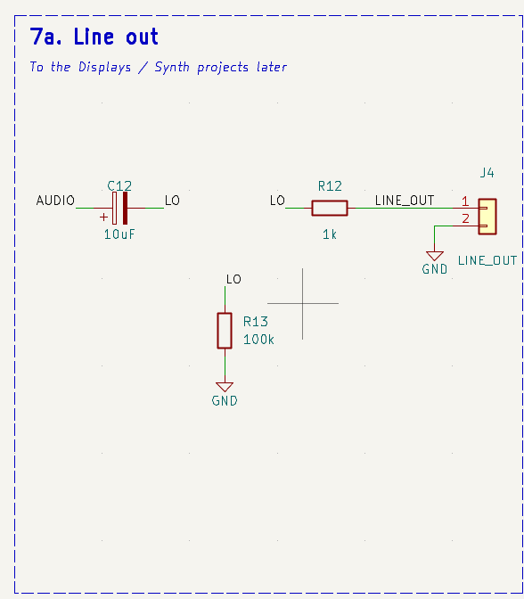

**Headphone amp:** LM386 at x20. R14 + C17 keep it from oscillating, C18 blocks DC from the headphones, and R15 limits the max volume. Tip and ring are tied together so both ears get the signal.

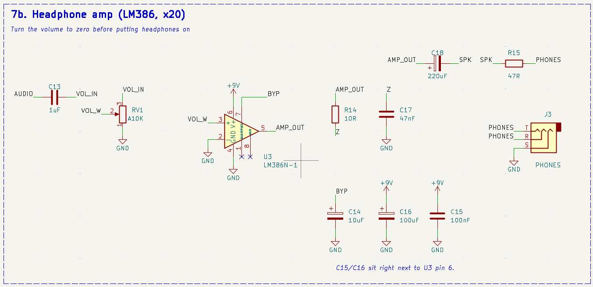

### Checks

KiCad's Electrical Rules Checker: **0 errors**. The 2 warnings are KiCad 10 noticing that the LED and potentiometer symbols have newer artwork in its library; the pins are identical.

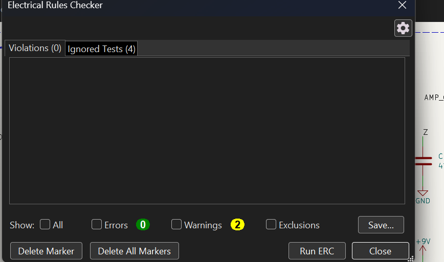

Every part has a footprint assigned:

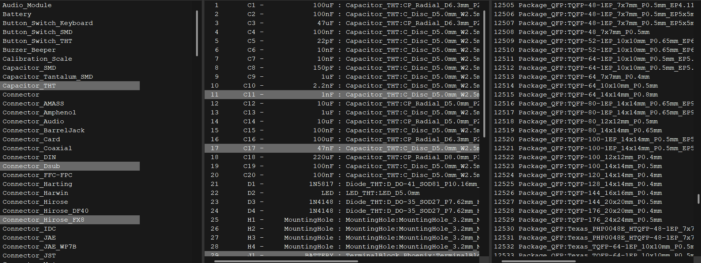

+9V and GND are in a "Power" net class so they get thicker 0.6 mm tracks on the PCB (signals get 0.3 mm):

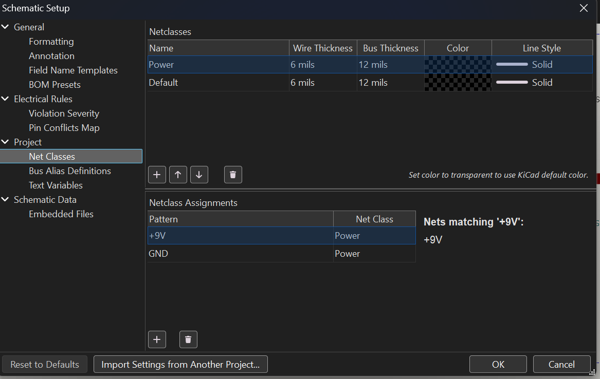

## PCB

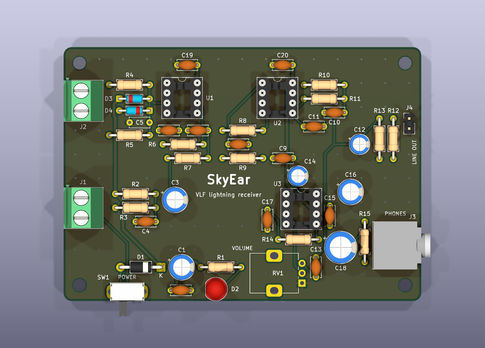

| | |
| --- | --- |
| Size | 90 × 64 mm, 2 layers, 1.6 mm FR-4, 4 × M3 mounting holes |
| Tracks | 0.3 mm signal, 0.6 mm for +9V and GND, 0.25 mm clearance |
| Ground | GND pour on both layers, stitched together with vias |
| Checks | KiCad DRC: **0 errors, 0 unconnected pads, 0 schematic mismatches** ([report](pcb/skyear_drc_report.rpt)) |

The 14 DRC warnings are all expected: 13 are connector bodies (terminal blocks, switch, jack, LED) that hang over the board edge on purpose, and 1 is the headphone jack footprint, whose pin slots were widened from 0.4 mm to 0.6 mm because JLCPCB can't make plated slots narrower than 0.5 mm.

### Layout

- **Signal flows left to right.** Antenna in on the left edge, then the buffer (U1), hum filter, gain stage (U2) and low-pass filter across the top. The headphone amp (U3), volume knob and jack are along the bottom right.
- **The antenna input is kept tiny.** Everything touching the 10 MΩ input node (R4, R5, D3, D4, C5) sits right next to U1 pin 3, because that node picks up hum if its traces are long.
- **The headphone amp is far from the input.** The LM386's output (the loudest signal on the board) is in the opposite corner from the antenna, so it can't feed back into the input and squeal.
- **Every chip has its 100 nF decoupling cap next to its power pin** (C19 for U1, C20 for U2, C15 for U3).
- **Controls are on the edges.** Battery and antenna terminals on the left, power switch and volume on the bottom, headphone jack and line out on the right.
- Routed with [Freerouting](https://github.com/freerouting/freerouting), then GND pours on both layers.

| Front copper | Back copper |
| --- | --- |
| 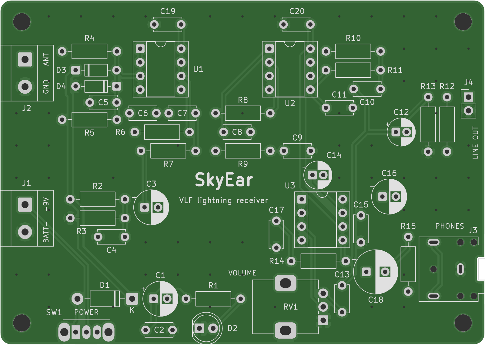 | 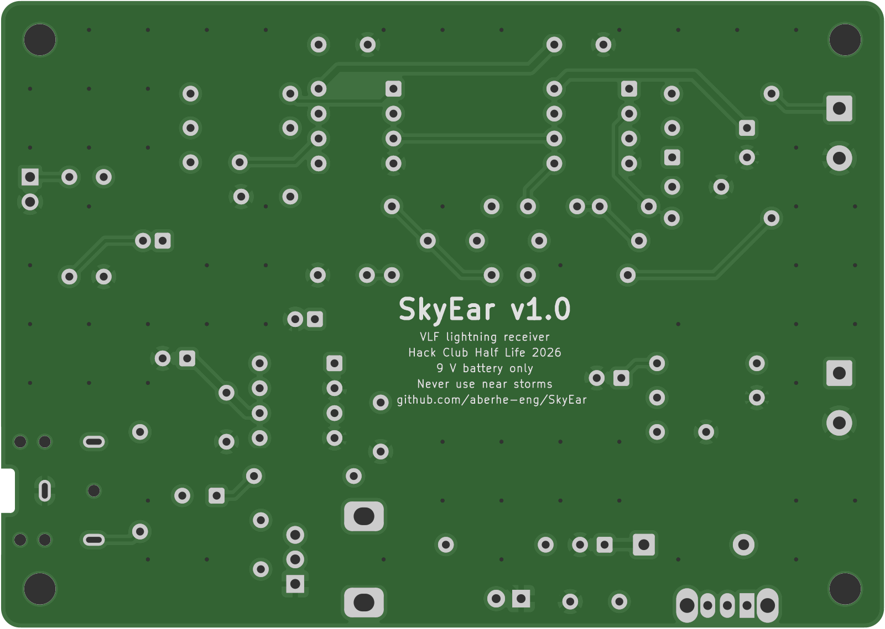 |

The front/back images are rendered straight from the Gerber files, so they show exactly what gets manufactured. The 3D views are from KiCad; the volume pot has no 3D model in KiCad's library, so only its pads show.

### Ordering the boards

[`pcb/skyear_gerbers_jlcpcb.zip`](pcb/skyear_gerbers_jlcpcb.zip) is ready to upload at [jlcpcb.com/quote](https://jlcpcb.com/quote) (2 layers, 1.6 mm, 5 pcs, any color). The individual Gerber and drill files are in [`pcb/gerbers/`](pcb/gerbers/). The board file is `pcb/skyear.kicad_pcb` (KiCad 10).

## Specs

| | |
| --- | --- |
| Frequency range | ~600 Hz to ~10.7 kHz |
| Power | One 9 V battery, ~10–15 mA |
| Input | Wire antenna + ground stake, 10 MΩ input resistance |
| Outputs | 3.5 mm headphones (with volume), 2-pin line out |
| Parts | 100% through-hole, all chips socketed |
| Board | 2 layers, 90 × 64 mm, 4 × M3 mounting holes |

## Parts list

[`bom.csv`](bom.csv) has every part with its quantity, real DigiKey price and part number, plus the PCBs from JLCPCB.

- Parts from DigiKey: **$29.67** (34 lines, including spares of the cheap parts)
- 5 PCBs from JLCPCB: **$2.00**
- **Parts total: $31.67**, before tax and shipping. That's inside the Tier 2 budget ($65).

Not on the list: a 9 V battery (any store) and the antenna wire + ground stake (already owned).

There's no firmware: SkyEar is entirely analog.

## Status

- [x] Circuit design and filter math
- [x] Schematic (KiCad), 0 errors in the electrical rules check
- [x] Price the BOM (Tier 2)
- [x] PCB layout and routing, 0 DRC errors
- [x] Gerber files for fabrication
- [ ] Build week: solder and test
- [ ] Field test: record real sferics and post the audio here

## Safety

- **Never set up the antenna when there are storms nearby.** If you can hear thunder, pack up. SkyEar listens to lightning far away, never close.
- **Battery power only.** Never connect it to a wall adapter.
- **Turn the volume to zero before putting headphones on.**
- Keep antennas far away from overhead power lines.
